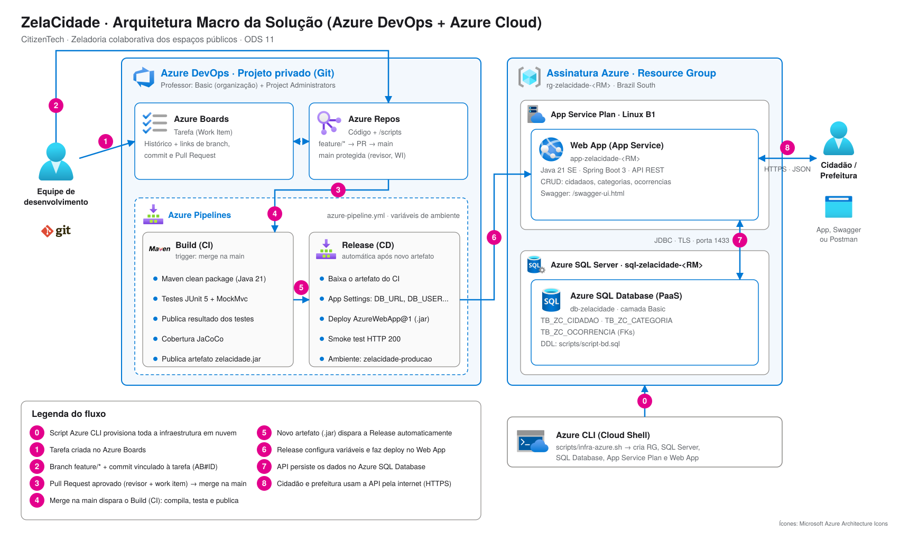

# ZelaCidade 🏙️ — Zeladoria colaborativa dos espaços públicos

> **Global Solution 2026/2 · CitizenTech** — DevOps Tools & Cloud Computing (FIAP · TDSR)

**Grupo: ZelaTech**

| Integrante | RM | Turma |
|---|---|---|
| Henrique Pecora | RM556612 | TDSR |
| Santhiago de Gobbi | RM98420 | TDSR |

- **Link da organização no Azure DevOps:** `https://dev.azure.com/MR556612`
- **Vídeo (YouTube):** https://youtu.be/l4gZk-F-RKk
- **API publicada:** `https://app-zelacidade-rm556612.azurewebsites.net` · Swagger: `/swagger-ui.html`

---

## 1. A solução

**O problema.** Buracos na rua, postes apagados, calçadas quebradas e lixo descartado irregularmente afetam a segurança, a mobilidade e a acessibilidade de quem vive nas cidades, sobretudo de idosos, pessoas com deficiência e moradores da periferia. Hoje o cidadão não sabe onde reclamar, não acompanha o andamento e a prefeitura não tem dados organizados para priorizar o que resolver primeiro.

**Quem é beneficiado.** O cidadão, que registra o problema em poucos segundos e acompanha o status, e a prefeitura ou subprefeitura, que recebe as ocorrências categorizadas, com localização, prioridade e prazo de atendimento.

**Como funciona.** O cidadão se cadastra e abre uma **ocorrência** informando título, endereço, coordenadas (latitude/longitude) e a **categoria** do problema. Cada categoria tem um prazo de atendimento. Toda ocorrência nasce com status `ABERTA` e evolui para `EM_ANALISE`, `EM_ATENDIMENTO`, `RESOLVIDA` ou `CANCELADA`. A consulta pode ser filtrada por status, o que alimenta painéis da prefeitura.

**ODS da ONU.** **ODS 11 — Cidades e comunidades sustentáveis** (meta 11.7: espaços públicos seguros, inclusivos e acessíveis) e **ODS 10 — Redução das desigualdades** (dá voz a bairros que historicamente recebem menos atenção).

---

## 2. Arquitetura macro



| # | Fluxo |
|---|---|
| 0 | O script **Azure CLI** (`scripts/infra-azure.sh`) provisiona Resource Group, Azure SQL Server, Azure SQL Database, App Service Plan e Web App |
| 1 | A tarefa é criada no **Azure Boards** |
| 2 | O desenvolvedor cria a branch `feature/*` e faz commits vinculados à tarefa (`AB#<id>`) no **Azure Repos** |
| 3 | O **Pull Request** passa pelas políticas da `main` (revisor obrigatório, work item vinculado) e é feito o merge |
| 4 | O merge na `main` dispara o **Build (CI)**: Maven compila, executa os testes JUnit, publica resultados, cobertura e o artefato `.jar` |
| 5 | O novo artefato dispara automaticamente a **Release (CD)** |
| 6 | A Release configura as variáveis de ambiente e faz o deploy do `.jar` no **Azure App Service** |
| 7 | A API persiste os dados no **Azure SQL Database** (JDBC com TLS) |
| 8 | Cidadão e prefeitura consomem a API via HTTPS (app, Swagger ou Postman) |

---

## 3. Tecnologias

| Camada | Tecnologia |
|---|---|
| API | Java 21, Spring Boot 3.3 (Web, Data JPA, Validation, Actuator), Springdoc OpenAPI (Swagger) |
| Banco | Azure SQL Database (PaaS) — driver `mssql-jdbc` |
| Hospedagem | Azure App Service (Linux, Java SE 21) |
| Testes | JUnit 5, Mockito, MockMvc, JaCoCo (cobertura) |
| DevOps | Azure Boards, Azure Repos (Git), Azure Pipelines (YAML multi-stage) |
| Infra como código | Azure CLI (bash) |

---

## 4. Estrutura do repositório

```
.
├── azure-pipeline.yml          # Pipeline YAML: Build (CI) + Release (CD)
├── pom.xml
├── scripts/
│   ├── infra-azure.sh          # Provisionamento da infraestrutura (Azure CLI)
│   ├── infra-destroy.sh        # Remove os recursos depois da avaliação
│   └── script-bd.sql           # DDL das tabelas (Azure SQL)
├── docs/
│   ├── arquitetura.png / .svg  # Desenho da arquitetura macro
│   └── crud/                   # JSONs de exemplo para o CRUD de cada tabela
└── src/
    ├── main/java/br/com/fiap/zelacidade/
    │   ├── controller/         # Endpoints REST
    │   ├── dto/  exception/  model/  repository/
    └── test/java/...           # Testes automáticos executados no CI
```

> Não usamos Docker nesta solução (deploy em App Service), por isso não há pasta `/dockerfiles`.

---

## 5. Provisionamento da infraestrutura (Azure CLI)

No **Azure Cloud Shell (Bash)** ou em um terminal com `az login`:

```bash
git clone <url-do-azure-repos>
cd zelacidade
export RM=rm123456                         # seu RM
export SQL_PASSWORD='SuaSenhaForte#2026'   # a senha NÃO vai para o repositório
bash scripts/infra-azure.sh
```

Depois, crie as tabelas executando `scripts/script-bd.sql` em **Portal Azure → Banco SQL `db-zelacidade` → Editor de consultas**. Se o `sqlcmd` estiver instalado, o próprio script já executa o DDL.

Recursos criados:

| Recurso | Nome |
|---|---|
| Resource Group | `rg-zelacidade-<RM>` |
| Azure SQL Server | `sql-zelacidade-<RM>` |
| Azure SQL Database | `db-zelacidade` (Basic) |
| App Service Plan | `plan-zelacidade-<RM>` (Linux B1) |
| Web App | `app-zelacidade-rm556612` (Java 21 SE) |

---

## 6. Banco de dados

Três tabelas relacionadas (DDL em [`scripts/script-bd.sql`](scripts/script-bd.sql)):

| Tabela | Descrição | Relacionamentos |
|---|---|---|
| `TB_ZC_CIDADAO` | Cidadão que registra ocorrências | 1:N com ocorrência |
| `TB_ZC_CATEGORIA` | Tipo de problema e prazo de atendimento | 1:N com ocorrência |
| `TB_ZC_OCORRENCIA` | Problema registrado no espaço público | FK para cidadão e categoria |

---

## 7. Pipelines (Azure Pipelines)

Arquivo [`azure-pipeline.yml`](azure-pipeline.yml) na raiz do repositório.

**Build (CI)**: disparado **somente por commits na `main`**, que só recebe código por Pull Request (`trigger: main`, `pr: none`).
1. Maven `clean package` com JDK 21
2. Executa os testes automáticos (JUnit 5 + MockMvc) e publica os resultados (aba *Tests*)
3. Publica a cobertura de código (JaCoCo)
4. Publica o artefato `zelacidade-app` (`zelacidade.jar` + scripts)

**Release (CD)**: roda automaticamente após o Build gerar um novo artefato.
1. Baixa o artefato do CI
2. Configura as variáveis de ambiente do App Service (`DB_URL`, `DB_USERNAME`, `DB_PASSWORD`)
3. Faz o deploy do `.jar` no Web App (`AzureWebApp@1`)
4. Smoke test: aguarda HTTP 200 da aplicação publicada

**Variáveis de ambiente**

| Variável | Onde fica | Secreta |
|---|---|---|
| `azureSubscription`, `webAppName`, `resourceGroup` | `azure-pipeline.yml` | Não |
| `DB_URL`, `DB_USERNAME` | Pipeline → *Variables* | Não |
| `DB_PASSWORD` | Pipeline → *Variables* | **Sim** (cadeado) |

Nenhuma senha está no código: `application.properties` lê `${DB_URL}`, `${DB_USERNAME}` e `${DB_PASSWORD}`.

---

## 8. Endpoints e CRUD (JSON)

Base URL: `https://app-zelacidade-rm556612.azurewebsites.net` · Swagger: `/swagger-ui.html`

| Método | Rota | Descrição |
|---|---|---|
| GET | `/` | Identificação e versão da API |
| POST / GET | `/api/cidadaos` | Cria / lista cidadãos |
| GET / PUT / DELETE | `/api/cidadaos/{id}` | Busca / atualiza / exclui cidadão |
| POST / GET | `/api/categorias` | Cria / lista categorias |
| GET / PUT / DELETE | `/api/categorias/{id}` | Busca / atualiza / exclui categoria |
| POST / GET | `/api/ocorrencias` (`?status=ABERTA`) | Cria / lista (filtra por status) |
| GET / PUT / DELETE | `/api/ocorrencias/{id}` | Busca / atualiza / exclui ocorrência |

### 8.1 Cidadão — `/api/cidadaos`

**POST** `/api/cidadaos`
```json
{
  "nome": "Maria Souza",
  "email": "maria.souza@email.com",
  "telefone": "11999990000",
  "bairro": "Vila Mariana"
}
```
**PUT** `/api/cidadaos/1`
```json
{
  "nome": "Maria Souza Lima",
  "email": "maria.souza@email.com",
  "telefone": "11988887777",
  "bairro": "Moema"
}
```
**DELETE** `/api/cidadaos/1` → `204 No Content`

### 8.2 Categoria — `/api/categorias`

**POST** `/api/categorias`
```json
{
  "nome": "Semáforo com defeito",
  "descricao": "Semáforo apagado ou piscando em amarelo",
  "prazoAtendimentoDias": 2
}
```
**PUT** `/api/categorias/5`
```json
{
  "nome": "Semáforo com defeito",
  "descricao": "Semáforo apagado, piscando ou com tempo errado",
  "prazoAtendimentoDias": 1
}
```
**DELETE** `/api/categorias/5` → `204 No Content`

### 8.3 Ocorrência — `/api/ocorrencias`

**POST** `/api/ocorrencias` (status sempre nasce `ABERTA`)
```json
{
  "titulo": "Buraco em frente à escola",
  "descricao": "Buraco grande que obriga os carros a desviar para a calçada",
  "endereco": "Rua Domingos de Morais, 1500 - Vila Mariana",
  "latitude": -23.588400,
  "longitude": -46.632400,
  "prioridade": 5,
  "cidadaoId": 1,
  "categoriaId": 1
}
```
**PUT** `/api/ocorrencias/1` (muda o status)
```json
{
  "titulo": "Buraco em frente à escola",
  "descricao": "Equipe enviada para tapar o buraco",
  "endereco": "Rua Domingos de Morais, 1500 - Vila Mariana",
  "latitude": -23.588400,
  "longitude": -46.632400,
  "prioridade": 5,
  "status": "EM_ATENDIMENTO",
  "cidadaoId": 1,
  "categoriaId": 1
}
```
**DELETE** `/api/ocorrencias/1` → `204 No Content`

Os mesmos JSONs estão em [`docs/crud/`](docs/crud/).

**Comprovação no banco** (Editor de consultas do Portal Azure):
```sql
SELECT * FROM dbo.TB_ZC_CIDADAO;
SELECT * FROM dbo.TB_ZC_CATEGORIA;
SELECT * FROM dbo.TB_ZC_OCORRENCIA;
```

---

## 9. Executar localmente (opcional)

```bash
export DB_URL='jdbc:sqlserver://sql-zelacidade-<RM>.database.windows.net:1433;database=db-zelacidade;encrypt=true;trustServerCertificate=false;hostNameInCertificate=*.database.windows.net;loginTimeout=30;'
export DB_USERNAME=zcadmin
export DB_PASSWORD='SuaSenhaForte#2026'
mvn spring-boot:run          # http://localhost:8080/swagger-ui.html
mvn test                     # roda os testes automáticos
```

---

## 10. Uso de IA generativa

| Ferramenta | Para quê |
|---|---|
| Claude (Anthropic) | Apoio na estrutura do projeto, nos scripts Azure CLI, no YAML da pipeline, no desenho da arquitetura e na revisão deste README. Todo o conteúdo foi revisado, testado e entendido pela equipe. |
